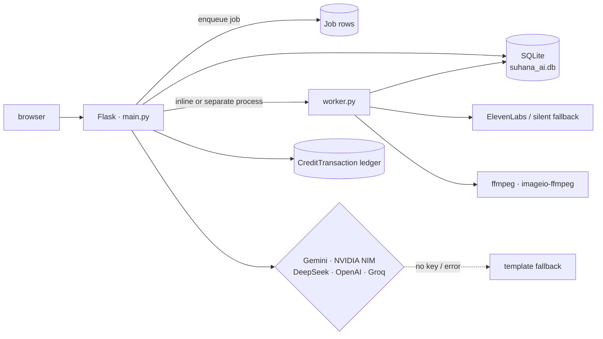

# Suhana AI

**A Flask studio for script generation, image generation, reel rendering and file tooling — built so that a missing provider key degrades the feature instead of breaking it.**

One login, one credit ledger, one job queue. Script → images → voiceover → 9:16 reel,
plus PDF merge and an image editor, on a stack small enough to run on a single box.

`Flask` `SQLAlchemy` `SQLite` `ffmpeg` `Docker`

> No hosted demo. The studio is only meaningful with provider keys, and a public
> deployment of a credit-metered product invites someone else's bill.

---

## Why this exists

Script generation, video rendering, and file utilities are normally five subscriptions
with five billing relationships and five failure modes. Suhana collapses them into one
account with one meter — and, more importantly, treats "the model provider is down" as a
normal condition rather than an exception.

## What it does

| Area | Capability |
| :-- | :-- |
| Studio | script generation (multi-provider with template fallback), visual generation, script → reel |
| Reels | ffmpeg render to 360×640, per-scene segments, ElevenLabs or DeepSeek voiceover, silent-audio fallback |
| Tools | PDF merge, image editor (local edits plus prompt-based) |
| Accounts | email/password and Google OAuth scaffold, session cookies (`HttpOnly`, `SameSite=Lax`, `Secure` when configured) |
| Metering | free allowance of 3 per feature, 1 guest try, credit ledger, BYOK mode |
| Keys | an API vault that encrypts user-supplied keys at rest (Fernet) |
| Jobs | background worker with `pending → processing → completed / failed` |

## Architecture



`generate_process.py` runs the same worker as its own process, which is the shape you
want the moment the app stops being a demo. `PROCESS_REELS_INLINE=1` keeps it in the
request for development.

### The reel pipeline

1. A reel folder holds `desc.txt` (the script), `input.txt` (a concat-style file list) and
   the uploaded or generated images.
2. `text_to_audio()` asks ElevenLabs for narration; on failure it writes silent audio of
   the estimated duration (`max(5, min(60, words × 0.42 + 2))` seconds), so the timeline
   still exists.
3. `make_segment()` loops over the source images, scaling and padding each to the target
   frame for its slice of the timeline.
4. `create_reel()` concatenates the segments and muxes the audio, via `ffmpeg` from
   `imageio-ffmpeg` when the system binary is absent.

## Design decisions

1. **Degrade, never 500.** Every generation path answers the same question first: what is
   the useful output when the provider is missing, rate-limited, or wrong? Scripts fall
   back to templates, images to placeholders, audio to silence sized to the script. The
   pipeline keeps producing artefact files, which is what makes the feature testable
   offline.
2. **Two billing modes, one gate.** `generation_mode` is either `managed` (credits are
   spent) or `byok` (the user's own key, nothing is spent). The gate is a single
   `has_credits()` check — a `byok` user passes it without spending anything, so both
   modes run the same feature code.
3. **Metering reads the rows the feature writes.** Usage is derived from `VisualAsset`,
   `Reel` and `Script` counts rather than a separate counter, so the meter cannot drift
   from reality — the usual failure of a hand-maintained counter.
4. **The ledger is append-only.** Credits never move without a `CreditTransaction` row
   (amount + reason), so a balance can always be reconstructed and a support question
   answered.
5. **Keys are encrypted at rest, never echoed.** `encrypt_secret()` / `decrypt_secret()`
   wrap Fernet; the vault UI shows what exists, not what it says. `ENCRYPTION_KEY` unset
   means the feature refuses rather than storing plaintext.
6. **Uploads are bounded and typed.** `MAX_UPLOAD_MB` (64) caps request size and the
   editor accepts only `png/jpg/jpeg` — the two cheapest ways to avoid a trivial
   denial-of-service on a small box.
7. **Rate limits keyed on user or IP.** `POST` endpoints in `RATE_LIMITED_ENDPOINTS` are
   capped at 18 per 300 s per client, bucketed by session user when signed in and by
   `X-Forwarded-For` otherwise (the app runs behind `ProxyFix`).

## Quick start

```bash
python -m venv .venv && source .venv/bin/activate     # Windows: .venv\Scripts\activate
pip install -r requirements.txt
cp .env.example .env        # FLASK_SECRET_KEY + any provider keys you have
python main.py              # http://127.0.0.1:5000
```

Useful switches (all in `.env.example`):

| Variable | Effect |
| :-- | :-- |
| `STRICT_AI_MODE=1` | refuse template fallbacks; every path must reach a real provider |
| `PROCESS_REELS_INLINE=1` | render reels in-request instead of the worker |
| `START_BACKGROUND_WORKER=1` | start the worker thread with the app |
| `DEMO_FRESH_ALLOWANCE=1` | ignore prior usage so a demo always has a free run |
| `ENABLE_DEV_ADMIN=1` | expose the dev credit manager |

Docker: `docker build -t suhana . && docker run -p 5000:5000 --env-file .env suhana`.
`fly.toml`, `render.yaml` and `Procfile` are included for the three PaaS targets that
were evaluated.

## Verification

```bash
python qa_flask_smoke.py     # route-level smoke test
python qa_flask_deep.py      # deeper flow coverage
```

## Limits

- **Single-tenant monolith.** One SQLite file, one process, one upload directory. Correct
  for a studio MVP, wrong for the same product with customers — the migration path is
  Postgres plus a real object store, and that work has not been done.
- **SQLite and a background thread** mean a restart mid-render leaves a `processing` job
  that needs manual requeue.
- **Provider coverage is broad but shallow**: several integrations share one prompt shape;
  the studio is not tuned per model.
- **In-process state.** The rate-limit buckets and the AI response cache
  (`AI_RESPONSE_CACHE`, 15-minute TTL, cleared past 120 entries) live in memory, so they
  do not survive a restart or a second process.

## Author

**Mohd Ayaan** — [github.com/sheikhayaan](https://github.com/sheikhayaan) ·
[LinkedIn](https://linkedin.com/in/mohd-ayaan-7731b4381)
